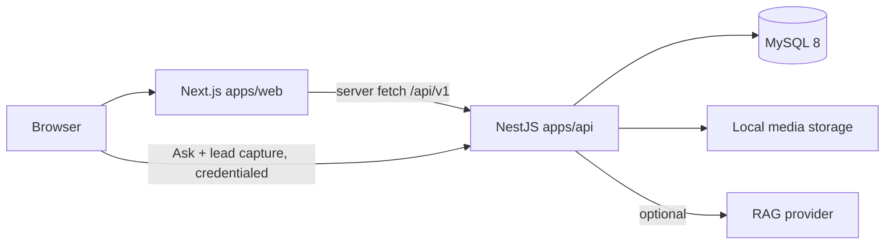

# Influential Minds

A production-oriented content platform for the _Influential Minds_ conversation series: a public archive of long-form interviews, an editorial CMS, and **Ask the Archive**, a grounded retrieval feature that answers questions with timecoded links into the source conversations.

This replaces the earlier single-page Vite mockup. The static arrays, `alert()` placeholders and simulated search are gone; everything is now served from MySQL through a versioned API.

---

## Architecture

```
influential-minds/
├─ apps/
│  ├─ api/        NestJS 11 + Prisma + MySQL 8 — the /api/v1 surface
│  └─ web/        Next.js 15 App Router — public site + editorial console
├─ packages/
│  └─ contracts/  Shared Zod schemas, response types, YouTube/timecode helpers
├─ docs/          Deployment, API reference, admin and QA guides
└─ legacy/        The original HTML prototype, kept for reference only
```



The two apps deploy independently and share nothing but `@influential-minds/contracts`, so a change to a response shape fails the typecheck on both sides rather than at runtime.

**Why this split.** The public site renders on the server for SEO and so the archive works without JavaScript; the API owns the database, admin sessions, rate limiting and retrieval. GitHub Pages is no longer used — the site is no longer static.

---

## Requirements

| Tool    | Version                                                     |
| ------- | ----------------------------------------------------------- |
| Node.js | 20.11+ (22 LTS recommended)                                 |
| pnpm    | 10.4.1 (pinned via `packageManager`; run `corepack enable`) |
| MySQL   | 8.0+                                                        |

---

## Quick start

### With Docker (nothing to install but Docker)

```bash
docker compose up --build
```

That starts MySQL, applies the migrations, seeds verified content and the first
admin user, then runs both apps:

- Web: <http://localhost:3000>
- API: <http://localhost:4000/api/v1>
- Console: <http://localhost:3000/admin> — `admin@influentialminds.local` / `ChangeMe123!`

MySQL is exposed on host port **3307** so an existing local MySQL is not
disturbed. `docker compose down -v` discards the database and uploaded media.
The credentials in `docker-compose.yml` are development defaults only.

### Without Docker

Requires a MySQL 8 instance you can reach.

```bash
corepack enable
pnpm install

# 1. Configure
cp apps/api/.env.example apps/api/.env
cp apps/web/.env.example apps/web/.env.local
#    Then edit DATABASE_URL and AUTH_SECRET in apps/api/.env.

# 2. Create the schema and the first admin user
pnpm db:deploy
pnpm db:seed

# 3. Run both apps
pnpm dev
```

- Web: <http://localhost:3000>
- API: <http://localhost:4000/api/v1>
- Editorial console: <http://localhost:3000/admin>

`pnpm db:seed` prints the seeded admin credentials. Set `SEED_ADMIN_EMAIL` and `SEED_ADMIN_PASSWORD` before running it, and change the password after first sign-in.

---

## Scripts

| Command                         | Purpose                                                  |
| ------------------------------- | -------------------------------------------------------- |
| `pnpm dev`                      | Run the API and web app together                         |
| `pnpm dev:api` / `pnpm dev:web` | Run one app                                              |
| `pnpm build`                    | Build contracts → API → web, in order                    |
| `pnpm check`                    | Typecheck every package                                  |
| `pnpm test`                     | Run the unit tests                                       |
| `pnpm db:generate`              | Regenerate the Prisma client                             |
| `pnpm db:migrate`               | Create a migration from schema changes (development)     |
| `pnpm db:deploy`                | Apply committed migrations (CI and production)           |
| `pnpm db:seed`                  | Seed verified content, site settings and the first admin |
| `pnpm format`                   | Prettier across the repo                                 |

---

## What the platform does

**Public archive.** Episode index with search, topic filter and sorting; episode pages with the YouTube embed, key takeaways, pull quotes, a timecoded transcript and related conversations; guest, topic and collection pages; an About page; a dedicated Ask page. Every route emits `PodcastEpisode`, `VideoObject` or `Person` JSON-LD, and `sitemap.xml` is generated from the database.

**Editorial console** (`/admin`). Cookie-authenticated and role-aware (`SUPER_ADMIN`, `CONTENT_EDITOR`). Conversations with a draft → in review → published workflow, guests, topics, collections, transcript upload, a media library, subscribers with CSV export, lead magnets, site copy, and an audit log of every write.

**Ask the Archive.** Retrieval runs over stored transcript segments; the model only writes prose over passages that were actually retrieved. Every answer carries sources with a timestamp and a "watch this moment" link. Daily per-visitor quotas are enforced server-side. With `AI_PROVIDER=disabled` the feature disappears; with `mock` it returns clearly labelled development answers.

**Lead capture.** Name, email and explicit consent, with a honeypot field, duplicate-tolerant storage and an immediate download link.

Content is limited to what is verifiable from the published YouTube playlist — see `youtube_playlist_findings.md`. Unknown fields are left empty rather than invented, and missing biographies read "Pending editorial review."

---

## Documentation

| Document                                           | Contents                                                      |
| -------------------------------------------------- | ------------------------------------------------------------- |
| [docs/deployment.md](docs/deployment.md)           | Hosting both apps, environment variables, migrations, backups |
| [docs/api.md](docs/api.md)                         | Every `/api/v1` endpoint                                      |
| [docs/admin-guide.md](docs/admin-guide.md)         | Day-to-day editorial workflow, transcripts, CSV export        |
| [docs/ask-the-archive.md](docs/ask-the-archive.md) | Retrieval, grounding rules, providers, quotas                 |
| [docs/qa-checklist.md](docs/qa-checklist.md)       | Pre-launch verification                                       |
| [docs/roadmap.md](docs/roadmap.md)                 | Deliberately deferred to V2                                   |

---

## Licence

MIT.
