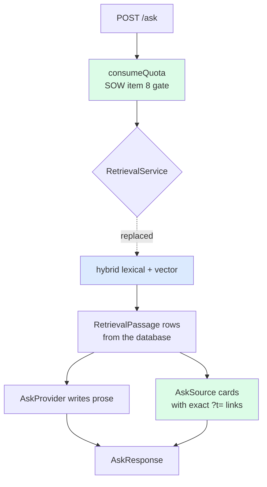

# Spec — semantic retrieval for Ask the Archive

**Status:** proposal. Nothing in this document is implemented.
**Supersedes:** the lexical scorer in `apps/api/src/ask/retrieval.service.ts`.
**Does not change:** citations, the Ask UI, or the daily query tiers in SOW item 8.

---

## 1. Problem

Retrieval is lexical. `RetrievalService.tokenize()` strips stop words and
`retrieve()` gathers candidates with `LIKE` before scoring on term coverage and
density (`retrieval.service.ts:152-205`). It matches **words, not meaning**.

A visitor asking "how do you avoid burning out?" will not reach a passage where
the guest said "I was completely depleted by the end of that year". The archive
contains the answer; the search cannot see it.

The goal is for retrieval to understand intent, without weakening the guarantee
that every citation is real.

## 2. What must not change

The no-hallucination property does **not** come from the model. It comes from
sources being database rows:

- `AskProvider.answer()` returns prose only, and is explicitly instructed not to
  emit timestamps or links (`ask.provider.ts:88`).
- `RetrievalService.toPassage()` builds every `AskSource` — `episodeSlug`,
  `startSeconds`, `timecode`, `momentUrl` — from the matched row.

That property is independent of **how** rows are ranked, which is why ranking
can be replaced wholesale and the guarantee survives untouched.

Equally, `AskService.ask()` consumes quota _before_ calling retrieval
(`ask.service.ts:64`). Everything in SOW item 8 — `ASK_DAILY_LIMITS`, the 429
body, the upgrade message — sits upstream and is unaffected.



Green is untouched. Only the blue box is new work.

## 3. Correction to the requested model

The brief asked for **`text-embedding-005`**. That model is Vertex AI only: it
requires a Google Cloud project and **service-account or OAuth2 credentials**,
not a simple API key. Wiring service-account JSON through Docker and CI is
materially heavier than this feature warrants, and Google's older
`text-embedding-00x` line is being retired in favour of the Gemini embedding
models.

**Recommended instead:** `gemini-embedding-001` on the Gemini API —

```
POST https://generativelanguage.googleapis.com/v1beta/models/gemini-embedding-001:embedContent
```

- authenticates with a plain **API key**, exactly like `BREVO_API_KEY`
- has a **free tier**, which is what was actually being asked for
- supports Matryoshka truncation, so we can request **768 dimensions** and keep
  vectors small without retraining

The model name stays configurable, so pointing at Vertex or a newer Gemini
embedding model later is a config change, not a code change.

## 4. The hard part: two providers cannot share one index

The brief asks for Gemini with a **local MiniLM fallback when the free tier is
exhausted**. There is a trap here that determines the whole design.

**Embeddings from different models are not comparable.** A Gemini 768-dim vector
and a MiniLM 384-dim vector occupy unrelated spaces. Cosine between them is
noise, not similarity. A naive fallback would not degrade gracefully — it would
return confident nonsense, which is worse than returning nothing.

**Solution: dual indexing.** Every passage is embedded with _both_ models at
ingest. Local embedding is free and runs in-process, so the only cost is a few
seconds of CPU per transcript. At query time the question is embedded with
whichever provider is available, and compared **only against vectors from that
same model**.

| Situation                 | Query embedded with | Compared against | Result                                |
| ------------------------- | ------------------- | ---------------- | ------------------------------------- |
| Normal                    | Gemini              | Gemini index     | Full quality                          |
| Free tier exhausted (429) | MiniLM              | MiniLM index     | Slightly lower recall, still semantic |
| Both unavailable          | —                   | —                | Falls back to today's lexical scorer  |

Three tiers of degradation, each one coherent. The lexical scorer is never
deleted; it becomes the floor.

## 5. Data model

Transcript segments are too short to embed well — WebVTT cues are often a single
clause. Segments are merged into **passages** of roughly 45 seconds or 600
characters, with one segment of overlap so a thought split across a boundary is
still reachable.

A passage's `startSeconds` is taken from its first real segment, so the citation
remains an exact timestamp.

```prisma
model TranscriptPassage {
  id           String  @id @default(cuid())
  transcriptId String
  startSeconds Int
  endSeconds   Int?
  text         String  @db.Text
  sortOrder    Int     @default(0)

  transcript Transcript          @relation(fields: [transcriptId], references: [id], onDelete: Cascade)
  embeddings PassageEmbedding[]

  @@index([transcriptId, startSeconds])
  @@map("transcript_passages")
}

model PassageEmbedding {
  id        String @id @default(cuid())
  passageId String
  /** e.g. "gemini-embedding-001" or "minilm-l6-v2". Vectors are only ever
      compared with others carrying the same model string. */
  model     String @db.VarChar(80)
  dim       Int
  /** Float32Array, L2-normalised at write time so cosine is a dot product. */
  vector    Bytes  @db.MediumBlob

  passage TranscriptPassage @relation(fields: [passageId], references: [id], onDelete: Cascade)

  @@unique([passageId, model])
  @@map("passage_embeddings")
}
```

MySQL 8.4 has no native `VECTOR` type, hence `MEDIUMBLOB`. At this corpus size
that is not a compromise:

| Corpus       | Passages | Gemini 768-dim | MiniLM 384-dim | Both in RAM |
| ------------ | -------- | -------------- | -------------- | ----------- |
| 10 episodes  | ~800     | 2.4 MB         | 1.2 MB         | **3.6 MB**  |
| 100 episodes | ~8,000   | 24 MB          | 12 MB          | 36 MB       |

A brute-force scan of 800 vectors is a few milliseconds. No vector database, no
index structure, no extra service is justified until the archive is ~10× larger.

**Why the database rather than the filesystem.** Vectors are written in the same
transaction as the passages, so they cannot drift from the transcript; they are
covered by the existing MySQL backups in `docs/deployment.md`; and a container
recreated without a volume cannot silently empty the index. The in-memory cache
is the fast path; the database is the truth.

## 6. Components

### 6.1 `EmbeddingProvider`

Mirrors the existing `AskProvider` and `MailProvider` shape — interface, string
injection token, `useFactory` switching on config.

```ts
export interface EmbeddingProvider {
  /** Identity stored on every vector; vectors are only compared within a model. */
  readonly model: string;
  readonly dim: number;
  readonly available: boolean;
  /** Returns one normalised vector per input, or null when the provider fails. */
  embed(
    texts: string[],
    kind: "document" | "query"
  ): Promise<Float32Array[] | null>;
}
```

Implementations:

- **`GeminiEmbeddingProvider`** — `embedContent`, API key header,
  `outputDimensionality: 768`, `taskType` of `RETRIEVAL_DOCUMENT` or
  `RETRIEVAL_QUERY`. Returns `null` on 429 or any failure rather than throwing.
- **`LocalEmbeddingProvider`** — `@huggingface/transformers` running
  `all-MiniLM-L6-v2` (384-dim) in-process. No key, no network.
- **`DisabledEmbeddingProvider`** — always `null`; retrieval stays lexical.

`taskType` matters: Gemini embeds questions and documents differently, and using
the wrong one measurably hurts recall.

### 6.2 Indexing

Hooks into the existing `TranscriptService.upload()` transaction
(`transcript.service.ts:133-168`), which already deletes and recreates the whole
transcript. Passages are built there; embedding runs immediately afterwards,
outside the transaction, and writes vectors per model.

Because `upload()` replaces everything, stale vectors are impossible — they
cascade away with the old transcript.

An admin **Reindex** action and a `pnpm db:reindex` script cover backfill, a
model change, or a free-tier failure during ingest. Passages missing a vector for
the active model are simply re-embedded.

Gemini's free tier is rate limited per minute, so ingest batches ~64 texts per
request with exponential backoff, and records per-model progress so a run can
resume rather than restart.

### 6.3 Retrieval

`RetrievalService.retrieve()` keeps its signature, so `AskService` needs no
change at all. Internally:

1. Embed the question (Gemini, else MiniLM, else skip).
2. Score every cached vector for that model by dot product.
3. Run the existing lexical scorer unchanged.
4. Fuse the two rankings with **Reciprocal Rank Fusion**, `1/(60 + rank)`.
5. Apply the existing one-passage-per-episode diversity rule
   (`retrieval.service.ts:207-217`).
6. Build `RetrievalPassage` objects exactly as today.

RRF is chosen deliberately over a weighted sum: lexical scores are 0–1 coverage
ratios and cosine similarities are not on the same scale, and rank fusion avoids
inventing a calibration constant that would need retuning per corpus.

**Threshold handling.** `AI_MIN_SCORE` currently gates `noMatch`
(`ask.service.ts:67`). Under fusion it keeps its meaning for the lexical arm, and
a new `AI_SEMANTIC_MIN_SCORE` (default `0.35` cosine) gates the vector arm. A
passage qualifies if **either** arm clears its threshold. The "I could not find
that in the archive yet" response is preserved for genuinely absent topics —
which matters, because a vector search always returns a nearest neighbour, and
without a floor it would confidently surface the least-irrelevant passage.

### 6.4 Cache

Vectors for the active model load into a `Map<string, Float32Array>` at boot and
refresh when a transcript is uploaded or reindexed. At 3.6 MB this is
unremarkable; it only needs revisiting if the API is ever scaled to multiple
replicas, where each would simply hold its own copy.

## 7. Configuration

Follows the `EMAIL_PROVIDER` pattern: default off, so nothing changes until it is
switched on.

| Variable                 | Default                   | Notes                                          |
| ------------------------ | ------------------------- | ---------------------------------------------- |
| `EMBEDDING_PROVIDER`     | `disabled`                | `gemini` \| `local` \| `disabled`              |
| `EMBEDDING_FALLBACK`     | `local`                   | Used when the primary returns 429 or fails     |
| `GEMINI_API_KEY`         | —                         | **Secret.** Required when provider is `gemini` |
| `GEMINI_EMBEDDING_MODEL` | `gemini-embedding-001`    |                                                |
| `GEMINI_EMBEDDING_DIM`   | `768`                     | Matryoshka truncation                          |
| `LOCAL_EMBEDDING_MODEL`  | `Xenova/all-MiniLM-L6-v2` | Baked into the image                           |
| `AI_SEMANTIC_MIN_SCORE`  | `0.35`                    | Cosine floor for the vector arm                |
| `EMBEDDING_BATCH_SIZE`   | `64`                      | Ingest batching                                |

Fail-fast validation as with Brevo: `EMBEDDING_PROVIDER=gemini` without
`GEMINI_API_KEY` refuses to boot.

**Deployment note.** The MiniLM weights (~90 MB) must be **baked into the Docker
image** in a build stage, not downloaded at boot. A runtime download would make
container start depend on Hugging Face being reachable, and would re-download on
every deploy. Expect the API image to grow by roughly 150 MB including
`onnxruntime-node`.

## 8. Cost

| Item                       | Volume       | Cost                       |
| -------------------------- | ------------ | -------------------------- |
| Initial index, 10 episodes | ~120k tokens | **free tier**, else ~$0.02 |
| Re-index after an edit     | one episode  | negligible                 |
| Per visitor question       | ~20 tokens   | ~$0.000003                 |
| Local fallback             | any          | **$0**                     |

Cost is not a design constraint here. Free-tier _rate_ limits are the only real
operational concern, and the local fallback exists precisely to absorb them.

## 9. Testing

Following the existing direct-construction style (`transcript-parser.spec.ts`),
since vitest/esbuild cannot compile Nest's decorator metadata:

- `splitIntoPassages()` — 45s/600-char windows, overlap, `startSeconds` always
  taken from a real segment, empty and single-segment transcripts.
- Vector codec — `Float32Array` → `Buffer` → `Float32Array` round-trip,
  normalisation, dimension mismatch rejected.
- `GeminiEmbeddingProvider` — stubbed `fetch`; correct endpoint, key header,
  `taskType` differs for query vs document; 429 and network error both return
  `null` rather than throwing.
- Fallback selection — a `null` from the primary routes to the fallback **and**
  queries the fallback's index, never the primary's.
- RRF fusion — a passage ranked highly by only one arm still surfaces; a passage
  ranked by both outranks it.
- Threshold — an off-topic question yields `noMatch` despite vectors always
  having a nearest neighbour.
- Regression — with `EMBEDDING_PROVIDER=disabled`, retrieval results are
  byte-identical to today's.

A small fixture set of real transcript text with expected paraphrase matches
("burnout" → "depleted") is worth more than any synthetic assertion here.

## 10. Effort

| Task                                          | Estimate      |
| --------------------------------------------- | ------------- |
| Schema, migration, vector codec               | 0.5 d         |
| Embedding providers, module, config           | 1.0 d         |
| Passage building + indexing + reindex command | 1.5 d         |
| Hybrid retrieval, fusion, cache               | 1.5 d         |
| Admin reindex UI and status                   | 0.5 d         |
| Tests                                         | 1.0 d         |
| Docs, Dockerfile model bake, CI               | 0.5 d         |
| **Total**                                     | **~6.5 days** |

Phaseable: tasks 1–4 deliver the capability; 5 is convenience; the feature can
ship behind `EMBEDDING_PROVIDER=disabled` and be switched on after the index is
built.

## 11. Risks

| Risk                                          | Mitigation                                                       |
| --------------------------------------------- | ---------------------------------------------------------------- |
| Mixed-model vectors compared by accident      | `model` on every row; retrieval filters by it; covered by a test |
| Free tier exhausted mid-ingest                | Resumable batched indexing; local provider completes the run     |
| Vector search always returns _something_      | `AI_SEMANTIC_MIN_SCORE` floor; `noMatch` path kept               |
| Image size / cold start from local model      | Baked at build time; loaded lazily on first fallback             |
| Quality regression vs lexical for exact names | Hybrid fusion keeps the lexical arm permanently                  |
| Index drifts from edited transcripts          | Written in the upload path; old vectors cascade-delete           |

## 12. Open questions

1. **Transcript source.** The archive currently has **0 transcript segments**.
   Nothing here is testable until real transcripts exist. YouTube auto-captions
   are the obvious seed, subject to editorial review.
2. **Prose provider.** This spec assumes MindStudio stays as written in the SOW.
   The two choices are fully independent.
3. **Contractual.** The SOW names MindStudio as the RAG platform. Adding Google
   for embeddings is an additional vendor and may warrant client sign-off.
4. **Scope.** This is retrieval quality work, not an item in the ten priced
   deliverables. It should be quoted separately rather than absorbed.
