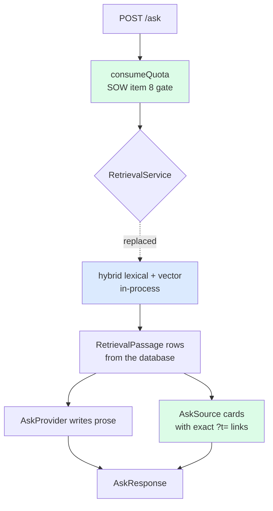

# Spec — semantic retrieval for Ask the Archive

**Status:** proposal. Nothing in this document is implemented.
**Supersedes:** the lexical scorer in `apps/api/src/ask/retrieval.service.ts`.
**Does not change:** citations, the Ask UI, or the daily query tiers in SOW item 8.
**No external service.** Embeddings run locally inside the existing API process.

---

## 1. Problem

Retrieval is lexical. `RetrievalService.tokenize()` strips stop words and
`retrieve()` gathers candidates with `LIKE` before scoring on term coverage and
density (`retrieval.service.ts:152-205`). It matches **words, not meaning**.

A visitor asking "how do you avoid burning out?" will not reach a passage where
the guest said "I was completely depleted by the end of that year". The archive
contains the answer; the search cannot see it.

The goal is for retrieval to understand intent, without weakening the guarantee
that every citation is real.

## 2. What must not change

The no-hallucination property does **not** come from the model. It comes from
sources being database rows:

- `AskProvider.answer()` returns prose only, and is explicitly instructed not to
  emit timestamps or links (`ask.provider.ts:88`).
- `RetrievalService.toPassage()` builds every `AskSource` — `episodeSlug`,
  `startSeconds`, `timecode`, `momentUrl` — from the matched row.

That property is independent of **how** rows are ranked, which is why ranking
can be replaced wholesale and the guarantee survives untouched.

Equally, `AskService.ask()` consumes quota _before_ calling retrieval
(`ask.service.ts:64`). Everything in SOW item 8 — `ASK_DAILY_LIMITS`, the 429
body, the upgrade message — sits upstream and is unaffected.



Green is untouched. Only the blue box is new work.

## 3. Decision: local embeddings only

An earlier draft paired a hosted Google model with a local fallback. That design
had a trap: **vectors from different models are not comparable.** A 768-dim
Gemini vector and a 384-dim MiniLM vector occupy unrelated spaces, so a cosine
between them is noise. Supporting both meant indexing every passage twice and
routing queries to the matching index — real complexity, for a corpus of a few
hundred passages.

**Running one local model removes that problem entirely.** What it buys:

|                                             | Local-only                |
| ------------------------------------------- | ------------------------- |
| Vendor accounts, API keys, billing          | none                      |
| Cost, at any volume                         | **$0**                    |
| Rate limits, quota exhaustion, 429 handling | n/a                       |
| Network dependency at query time            | none                      |
| Visitor questions sent to a third party     | none                      |
| Failure modes to design around              | one (model fails to load) |

The last two matter beyond engineering convenience. Visitor questions are the
most sensitive data the site handles, and keeping them in-process is consistent
with the stated position in `docs/roadmap.md` that no third-party scripts run on
the public site.

**The honest cost:** `all-MiniLM-L6-v2` is a 2021-era model and measurably weaker
than current hosted embeddings on paraphrase recall. For a ten-episode archive of
conversational English, that gap is small — and the hybrid design in §6.3 keeps
the lexical scorer alongside it, so a weaker vector arm degrades ranking rather
than breaking it. If the archive grows to the point where recall is the
bottleneck, swapping the model is a config change (§7), not a redesign.

## 4. Model

**`Xenova/all-MiniLM-L6-v2`**, 384 dimensions, via `@huggingface/transformers`
(the maintained successor to `@xenova/transformers`), running on
`onnxruntime-node` inside the existing Node 22 container (`apps/api/Dockerfile:4`).

| Property            | Value               | Consequence                             |
| ------------------- | ------------------- | --------------------------------------- |
| Dimensions          | 384                 | 1.5 KB per vector                       |
| **Max sequence**    | **256 word-pieces** | **Hard cap on passage length — see §5** |
| Weights (fp32 ONNX) | ~90 MB              | Baked into the image                    |
| Query latency       | ~5–15 ms CPU        | Invisible next to the LLM call          |
| Language            | English only        | Matches the archive                     |

The 256-token ceiling is the one constraint that shapes the data model. Anything
longer is **silently truncated**, not rejected — a passage whose second half is
never embedded would be invisible to search with no error anywhere. Passage size
is therefore a correctness concern, not a tuning preference.

`bge-small-en-v1.5` (also 384-dim, 512-token window, stronger on retrieval
benchmarks) is a drop-in alternative if quality proves insufficient. Keeping the
model id in config means that swap costs a reindex, nothing more.

## 5. Data model

Transcript segments are too short to embed well — WebVTT cues are often a single
clause. Segments are merged into **passages** of roughly 45 seconds or 600
characters (~130 word-pieces, comfortably inside the 256 ceiling), with one
segment of overlap so a thought split across a boundary is still reachable.

A passage's `startSeconds` is taken from its first real segment, so the citation
remains an exact timestamp.

```prisma
model TranscriptPassage {
  id           String  @id @default(cuid())
  transcriptId String
  startSeconds Int
  endSeconds   Int?
  text         String  @db.Text
  sortOrder    Int     @default(0)

  /** Model identity, e.g. "minilm-l6-v2". Vectors are only ever compared with
      others carrying the same value, so a model swap cannot silently mix
      incompatible spaces mid-reindex. */
  embeddingModel String? @db.VarChar(80)
  dim            Int?
  /** Float32Array, L2-normalised at write time so cosine is a dot product. */
  embedding      Bytes?  @db.MediumBlob
  embeddedAt     DateTime?

  transcript Transcript @relation(fields: [transcriptId], references: [id], onDelete: Cascade)

  @@index([transcriptId, startSeconds])
  @@map("transcript_passages")
}
```

With one model there is no need for a separate embeddings table; the vector is a
column on the passage. `embeddingModel` is still recorded because a reindex after
a model change is not instantaneous, and during it the table legitimately holds
two incompatible spaces. Retrieval filters on the active model, so a half-finished
reindex degrades to lexical rather than returning garbage.

MySQL 8.4 has no native `VECTOR` type, hence `MEDIUMBLOB`. At this corpus size
that is not a compromise:

| Corpus       | Passages | Vectors on disk | In RAM |
| ------------ | -------- | --------------- | ------ |
| 10 episodes  | ~800     | 1.2 MB          | 1.2 MB |
| 100 episodes | ~8,000   | 12 MB           | 12 MB  |

A brute-force scan of 800 vectors is sub-millisecond. No vector database, no
index structure, no extra service is justified until the archive is ~10× larger.

**Why the database rather than the filesystem.** Vectors are written alongside
the passages, so they cannot drift from the transcript; they are covered by the
existing MySQL backups in `docs/deployment.md`; and a container recreated without
a volume cannot silently empty the index. The in-memory cache is the fast path;
the database is the truth.

## 6. Components

### 6.1 `EmbeddingService`

With a single model there is no provider-selection problem, so this is a plain
service rather than the token-and-`useFactory` pattern used for `AskProvider` and
`MailProvider`. One switch remains:

```ts
@Injectable()
export class EmbeddingService {
  readonly model: string; // from config
  readonly dim = 384;
  get ready(): boolean; // false until the pipeline has loaded

  /** Normalised vectors, or null if the model is disabled or failed to load. */
  embed(
    texts: string[],
    kind: "document" | "query"
  ): Promise<Float32Array[] | null>;
}
```

- The pipeline is loaded **lazily on first use** and memoised, so boot time and
  the `/health` probe are unaffected.
- `embed()` returns `null` rather than throwing. A model that fails to load must
  degrade Ask to lexical search, never fail the request — the same contract as
  `BrevoMailProvider.request()`.
- `EMBEDDING_ENABLED=false` short-circuits to `null`, preserving today's exact
  behaviour and giving tests a deterministic off switch.
- `kind` is accepted now and unused by MiniLM, which embeds queries and documents
  identically. It is in the signature because asymmetric models (`bge-*`, `e5-*`,
  all hosted models) require a prefix or task type, and retrofitting it later
  would mean reindexing.

**Concurrency.** `onnxruntime-node` executes inference on its own native thread
pool, so a single `embed()` call does not block the event loop. Ingest still
batches and bounds concurrency so a large transcript cannot saturate the CPU the
API is serving requests with.

### 6.2 Indexing

Hooks into the existing `TranscriptService.upload()` transaction
(`transcript.service.ts:133-168`), which already deletes and recreates the whole
transcript. Passages are built inside that transaction; embedding runs
immediately afterwards, outside it, so a slow CPU cannot hold a write lock.

Because `upload()` replaces everything, stale vectors are impossible — they
cascade away with the old transcript. A re-upload is automatically a reindex.

An admin **Reindex** action and a `pnpm db:reindex` script cover backfill and
model changes. Both work by selecting passages whose `embeddingModel` differs
from the active one, so a run is idempotent and resumable by construction.

Expected initial index: ~800 passages, **under a minute** on a single core.

### 6.3 Retrieval

`RetrievalService.retrieve()` keeps its signature, so `AskService` needs no
change at all. Internally:

1. Embed the question. If `null`, skip to step 3 — this is the degraded path.
2. Score every cached vector for the active model by dot product.
3. Run the existing lexical scorer unchanged.
4. Fuse the two rankings with **Reciprocal Rank Fusion**, `1/(60 + rank)`.
5. Apply the existing one-passage-per-episode diversity rule
   (`retrieval.service.ts:207-217`).
6. Build `RetrievalPassage` objects exactly as today.

The lexical arm is retained permanently, not as a fallback. Vectors handle
paraphrase; keyword matching keeps proper nouns sharp — a question naming a guest
should return that guest, and embeddings are unreliable about rare names. The
two failure modes are close to complementary.

RRF is chosen over a weighted sum because lexical scores are 0–1 coverage ratios
and cosine similarities are not on the same scale; rank fusion avoids inventing a
calibration constant that would need retuning as the corpus grows.

**Threshold handling.** `AI_MIN_SCORE` currently gates `noMatch`
(`ask.service.ts:67`). Under fusion it keeps its meaning for the lexical arm, and
a new `AI_SEMANTIC_MIN_SCORE` (default `0.35` cosine) gates the vector arm. A
passage qualifies if **either** arm clears its threshold.

This floor is essential. A vector search always returns a nearest neighbour, so
without it the "I could not find that in the archive yet" response would
disappear entirely and off-topic questions would confidently surface the
least-irrelevant passage in the archive. The threshold is what keeps that answer
honest, and it should be tuned against real questions once transcripts exist.

### 6.4 Cache

Vectors for the active model load into a `Map<string, Float32Array>` at first
query and refresh when a transcript is uploaded or reindexed. At ~1.2 MB this is
unremarkable; it only needs revisiting if the API is scaled to multiple replicas,
where each would simply hold its own copy.

## 7. Configuration

Default off, so nothing changes until it is switched on. All optional values use
the existing `optional()` preprocess helper in `configuration.ts`, which treats a
blank `.env` entry as unset.

| Variable                | Default                   | Notes                                         |
| ----------------------- | ------------------------- | --------------------------------------------- |
| `EMBEDDING_ENABLED`     | `false`                   | Off ⇒ retrieval behaves exactly as today      |
| `EMBEDDING_MODEL`       | `Xenova/all-MiniLM-L6-v2` | Changing it requires a reindex                |
| `EMBEDDING_DIM`         | `384`                     | Validated against the loaded model at startup |
| `EMBEDDING_BATCH_SIZE`  | `32`                      | Ingest batching                               |
| `AI_SEMANTIC_MIN_SCORE` | `0.35`                    | Cosine floor for the vector arm               |

No secrets. Nothing to add to `docker-compose.yml` beyond pass-through, and
nothing to rotate.

**Deployment.** The model weights must be **baked into the Docker image** in a
build stage, not downloaded at boot — a runtime download would make container
start depend on Hugging Face being reachable and would re-fetch on every deploy.
Set the transformers cache directory to the baked path and disable remote
fetching so a missing model fails loudly at build time rather than silently
reaching the network in production.

Image impact: **~150 MB** (weights plus `onnxruntime-node` native binaries). The
binaries are platform-specific, so the image must be built for the deployment
architecture — building on an arm64 laptop for an amd64 host will produce an
image that fails at first inference, not at build.

## 8. Cost

Zero. No per-query cost, no per-episode cost, no account, no key, no vendor to
review. The only resource consumed is CPU already paid for.

## 9. Testing

Following the existing direct-construction style (`transcript-parser.spec.ts`),
since vitest/esbuild cannot compile Nest's decorator metadata:

- `splitIntoPassages()` — 45 s / 600-char windows, overlap, `startSeconds` always
  taken from a real segment, empty and single-segment transcripts.
- **Token ceiling** — no generated passage exceeds the model's sequence limit.
  This is the test that protects against silent truncation.
- Vector codec — `Float32Array` → `Buffer` → `Float32Array` round-trip,
  normalisation, dimension mismatch rejected.
- `EmbeddingService` — disabled returns `null`; a load failure returns `null`
  rather than throwing; vectors are unit length.
- Model filtering — a passage embedded with a different `embeddingModel` is
  excluded from scoring, simulating a half-finished reindex.
- RRF fusion — a passage ranked highly by only one arm still surfaces; a passage
  ranked by both outranks it.
- Threshold — an off-topic question yields `noMatch` despite vectors always
  having a nearest neighbour.
- Regression — with `EMBEDDING_ENABLED=false`, retrieval results are identical to
  today's.

Unit tests use fixed stub vectors, so the suite stays fast and deterministic and
CI never loads the model. One opt-in integration test exercises the real pipeline
against a small fixture of transcript text with expected paraphrase matches
("burnout" → "depleted"); that fixture is worth more than any synthetic assertion
about cosine values.

## 10. Effort

| Task                                                | Estimate      |
| --------------------------------------------------- | ------------- |
| Schema, migration, vector codec                     | 0.5 d         |
| `EmbeddingService` + config + Dockerfile model bake | 1.0 d         |
| Passage building, indexing, reindex command         | 1.0 d         |
| Hybrid retrieval, RRF fusion, cache                 | 1.5 d         |
| Admin reindex UI and status                         | 0.5 d         |
| Tests                                               | 0.5 d         |
| Docs and CI                                         | 0.5 d         |
| **Total**                                           | **~5.5 days** |

Phaseable. Tasks 1–4 deliver the capability; task 5 is convenience. The feature
can ship with `EMBEDDING_ENABLED=false` and be switched on once the index is
built and the thresholds are tuned against real questions.

## 11. Risks

| Risk                                             | Mitigation                                                        |
| ------------------------------------------------ | ----------------------------------------------------------------- |
| Passage silently truncated past 256 tokens       | Passage size capped below the limit; asserted in tests            |
| Vector search always returns _something_         | `AI_SEMANTIC_MIN_SCORE` floor; `noMatch` path kept                |
| Incompatible vectors during a model change       | `embeddingModel` per row; retrieval filters on it                 |
| Image size and cold start                        | Weights baked at build; pipeline loaded lazily and memoised       |
| Native binaries built for the wrong architecture | Build for the deployment platform; smoke-test inference in CI     |
| Recall weaker than a hosted model                | Lexical arm retained; model id is config-swappable                |
| Index drifts from edited transcripts             | Written in the upload path; old vectors cascade-delete            |
| CPU contention during a large ingest             | Bounded batch concurrency; embedding runs outside the transaction |

## 12. Open questions

1. **Transcript source.** The archive currently has **0 transcript segments**.
   Nothing here is testable, and Ask returns nothing today regardless of this
   work. YouTube auto-captions are the obvious seed, subject to editorial review.
   This is the real blocker for SOW item 8 and should be resolved first.
2. **Prose provider.** This spec assumes MindStudio stays as written in the SOW.
   Retrieval and prose generation are fully independent choices.
3. **Scope.** This is retrieval quality work, not one of the ten priced
   deliverables. It should be quoted separately rather than absorbed.
